<h1 align="center">COVID-19 host response</h1>

<p align="center">
  <strong>Identified an antiviral gene-expression signature.<br>
  Rebuilt the analysis for reproducibility.</strong>
</p>

<p align="center">
  An R/DESeq2 reanalysis of published nasal-swab RNA-seq from
  <a href="https://doi.org/10.1371/journal.pbio.3000849">Lieberman et al. (2020)</a>.
</p>

<p align="center">
  <a href="https://www.r-project.org/"></a>
  <a href="https://github.com/Ekin-Kahraman/bulk-rnaseq-differential-expression/actions/workflows/ci.yml"></a>
  <a href="https://doi.org/10.5281/zenodo.19429954"></a>
  <a href="LICENSE"></a>
</p>

<table>
  <tr>
    <td valign="top">Finding</td>
    <td>
      <strong>1,773 genes with altered expression</strong><br>
      An interferon-related antiviral response in 30 COVID-positive versus 30 negative samples, selected from a 484-sample dataset. FDR &lt; 0.05; |raw log₂FC| &gt; 1.
    </td>
  </tr>
  <tr>
    <td valign="top">Improvement</td>
    <td>
      <strong>Checked sample matching. Consistent gene IDs. Automated result checks.</strong><br>
      Rejects unmatched samples and invalid counts; cleans gene IDs and rebuilds results in a pinned environment with CI checks.
    </td>
  </tr>
  <tr>
    <td valign="top">Sensitivity</td>
    <td>
      <strong>99.8% agreement in direction of change</strong><br>
      Among 1,266 genes meeting thresholds in both the primary and full-cohort analyses. The samples overlap: this checks consistency, not independent replication.
    </td>
  </tr>
</table>

<p align="center">
  <a href="#results">Findings</a> ·
  <a href="#what-i-improved">What I improved</a> ·
  <a href="#quick-start">Run the analysis</a> ·
  <a href="#methods">Methods</a>
</p>

## Results

**The main signal is an interferon-related antiviral response.** The primary
comparison identified **979 upregulated and 794 downregulated genes**, including
increased expression of **IFIT1/2/3, CXCL10, DDX58 and OAS3**. These genes connect
viral RNA sensing with the host's antiviral defences.

<p align="center">
  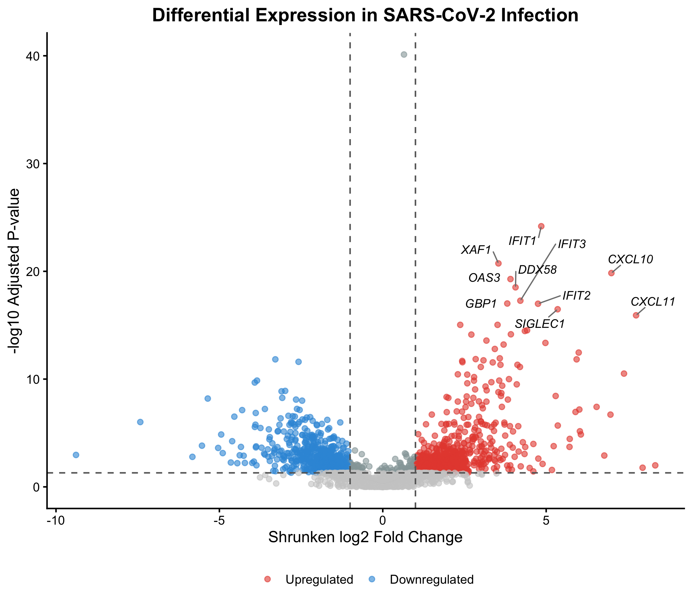
</p>

The **1,773-gene count** uses FDR &lt; 0.05 and |raw log₂FC| &gt; 1. The plot uses
`apeglm`-shrunken effect sizes, so the plotted fold-change threshold can select a
different set. The DESeq2 model adjusts for the recorded `gender` field.

[Gene-level results](results/tables/deseq2_results.csv) ·
[Shrunken effect estimates](results/tables/deseq2_results_shrunken.csv) ·
[Analysis summary](results/tables/analysis_summary.csv)

<details>
<summary><strong>Pathway evidence — antiviral and interferon-related biology</strong></summary>

**204 GO Biological Process terms** and **7 KEGG pathways** were enriched
at FDR &lt; 0.05 against the 13,279 genes eligible for differential-expression
selection. Enriched GO terms include response to virus and defence response
to virus, alongside cytoplasmic translation. The top KEGG pathway was
**Coronavirus disease – COVID-19** (FDR = 4.1 × 10<sup>−32</sup>), alongside
ribosomal, cytokine and innate immune signalling pathways.

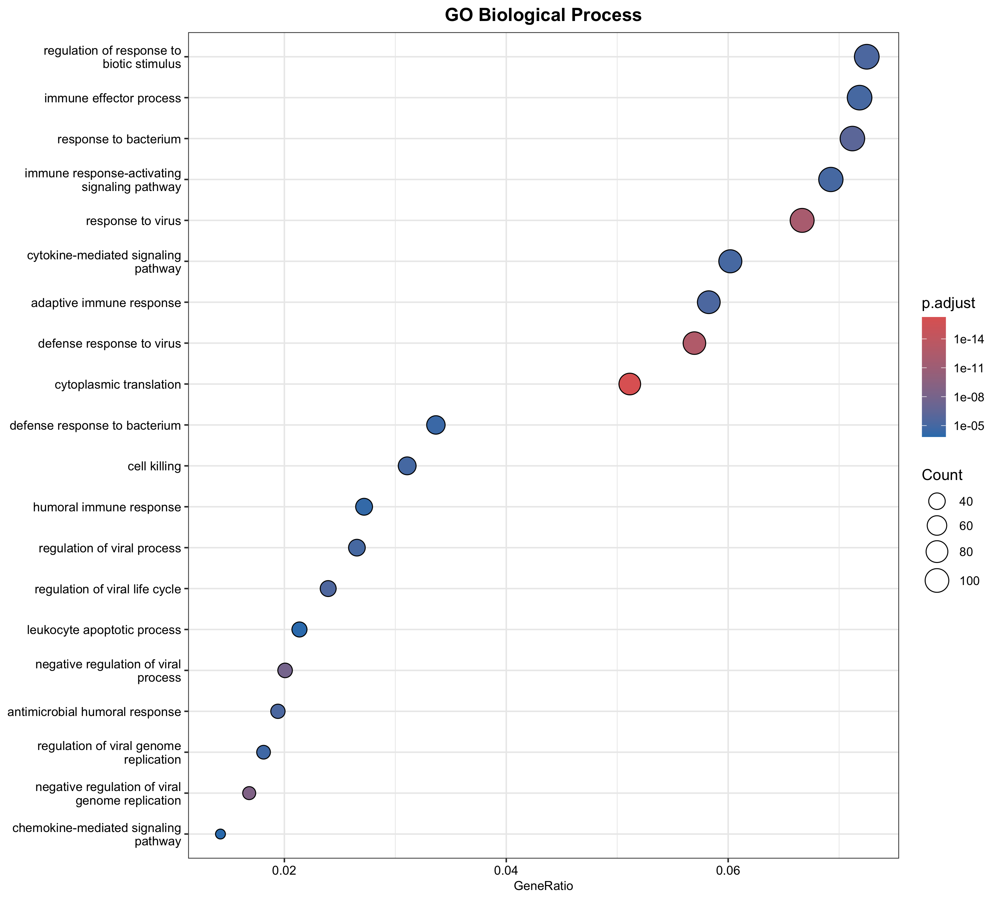

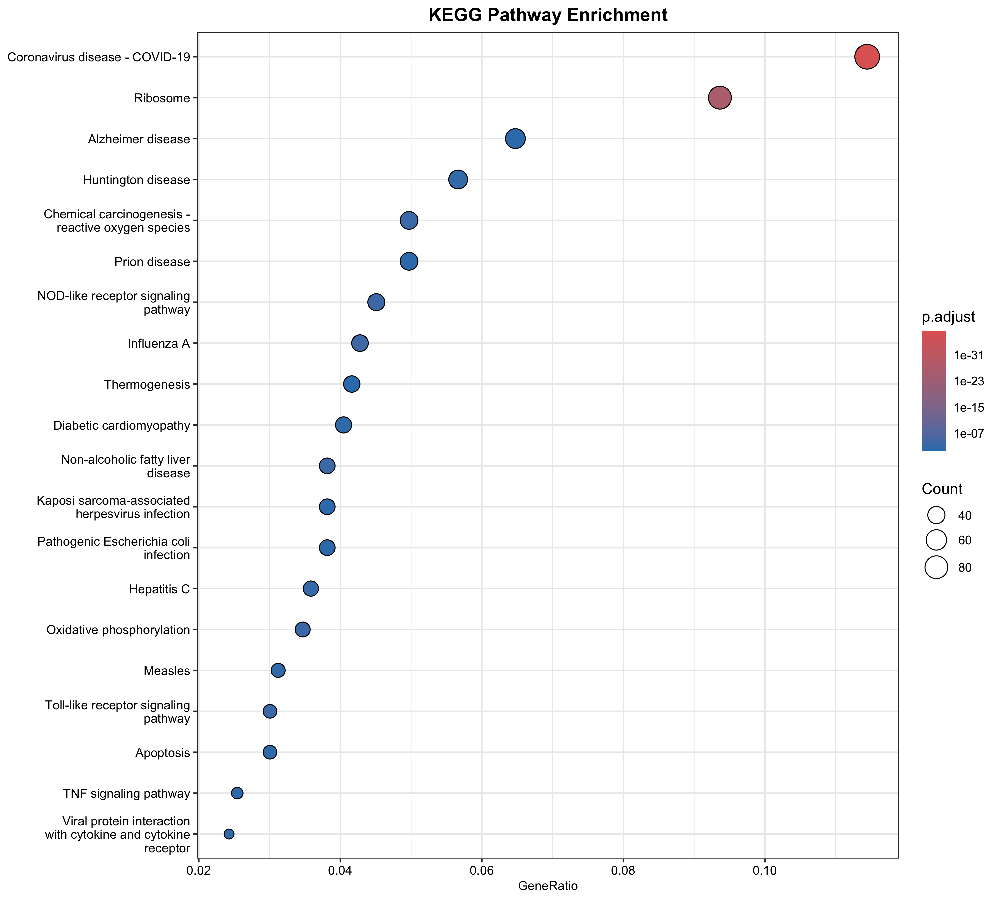

Induced genes also include GBP1, XAF1 and SIGLEC1. Together, the gene and pathway
results support an antiviral host-response interpretation; the signature is not
uniquely specific to SARS-CoV-2.

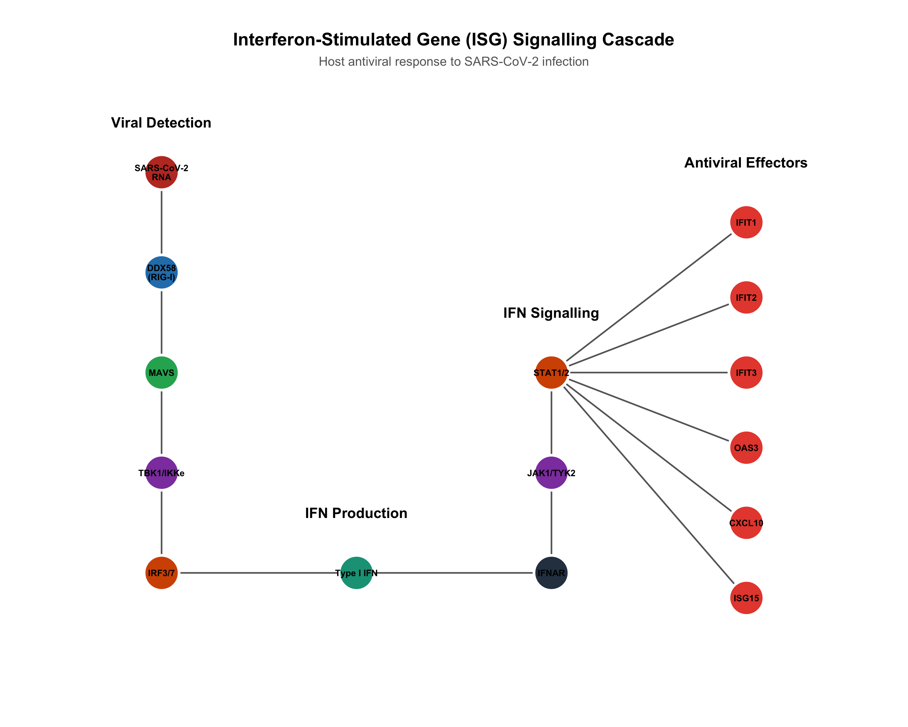

[GO results](results/tables/go_biological_process.csv) ·
[KEGG results](results/tables/kegg_pathways.csv) ·
[Tested-gene background](results/tables/enrichment_background.csv) ·
[Enrichment summary](results/tables/enrichment_summary.csv)

</details>

<details>
<summary><strong>Full-cohort sensitivity check — 99.8% directional agreement</strong></summary>

The full-cohort analysis yielded **4,378 genes** meeting the same raw-effect and
FDR thresholds. Of the **1,266 genes meeting thresholds in both analyses**,
**1,264 (99.8%)** had matching signs in their shrunken effect estimates.
Across all genes matched between the two result tables, the shrunken effect-size
Spearman correlation was **0.812**.

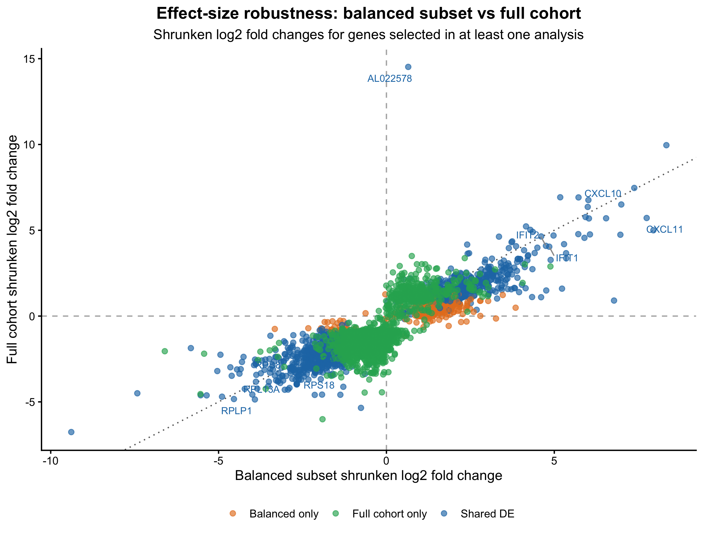

This checks how the primary result changes when more samples are used. Agreement
applies to the shared gene set; the analyses use overlapping samples and are not
independent replications. Both models adjust for the recorded `gender` field.

[Full-cohort results](results/tables/full_cohort_deseq2_results.csv) ·
[Sensitivity analysis code](scripts/09_sensitivity_analysis.R)

</details>

## What I improved

The [published study](https://doi.org/10.1371/journal.pbio.3000849) supplies the
data and biological context. This project adds a reproducible reanalysis with
explicit data checks and traceable outputs.

| Area | What changed | Why it matters |
| --- | --- | --- |
| **Sample matching** | Match counts to metadata by sample ID; reject unmatched or duplicate IDs; check ordering and remove unknown condition labels. | Prevents silent sample loss and checks that expression is paired with the correct metadata. |
| **Count integrity** | Reject missing, non-finite, negative or fractional counts before integer conversion. | Prevents silent truncation and the use of normalised expression as raw counts. |
| **Gene IDs** | Strip version suffixes and sum counts for duplicate gene IDs before modelling. | Combines entries referring to the same gene. |
| **Analysis checks** | Apply shared QC thresholds, use a fixed sampling seed, adjust for recorded sex and compare the balanced subset with the full cohort. | Makes the analysis choices explicit and checks sensitivity to sample selection. |
| **Reproducibility** | Pin software and KEGG references; record versions and output checksums; rebuild results and compare tables automatically in CI. | Lets another researcher rerun the workflow and check the outputs. |

The [original comparison script](https://github.com/greninger-lab/COVID19-RNAseq/blob/master/Fig1_ABC_Deseq_pos_v_neg.R)
assigns metadata names to count columns by position. This workflow matches shared
IDs, then checks that each retained count column is aligned with its metadata.

[Data import](scripts/00_get_data.R) · [QC and gene-ID handling](scripts/01_qc.R) ·
[CI rebuild checks](.github/workflows/ci.yml) · [Output manifest](results/tables/output_manifest.csv)

## Quick start

From the repository root:

```sh
# Restore the pinned R environment
Rscript 000_install_dependencies.R

# Download data as needed, then regenerate the analysis
Rscript run_all.R
```

**Input:** published gene counts and sample metadata from
[GSE152075](https://www.ncbi.nlm.nih.gov/geo/query/acc.cgi?acc=GSE152075).<br>
**Output:** gene-level results, pathway enrichment, figures, sensitivity analyses
and a record of the software and files used.

Allow approximately **2 GB for downloaded data** and **8 GB RAM**.
CI uses **R 4.5.2**. See the [reproducibility guide](REPRODUCIBILITY.md) for
environment setup, download behaviour and expected outputs.

<details>
<summary>Verification and maintenance commands</summary>

```sh
# Check the environment, lint and validate outputs
Rscript dev/check_renv_status.R
Rscript dev/lint.R
Rscript -e 'testthat::test_dir("tests/testthat")'

# Download again instead of using cached data
FORCE_DOWNLOAD=true Rscript scripts/00_get_data.R
```

The installer restores the pinned environment without modifying `renv.lock`.
Maintainers intentionally updating dependencies can run
`Rscript dev/snapshot_lockfile.R`.

</details>

## Methods

**Published counts → sample and gene checks → differential expression → pathway
analysis → sensitivity checks → reproducible outputs.**

The workflow starts from the published count matrix. It does not perform
raw-read alignment or quantification.

### Dataset

| Dataset | GSE152075 |
| --- | --- |
| Source | Lieberman et al., *PLOS Biology* (2020) |
| Material | Human nasopharyngeal swabs; Illumina NovaSeq 6000 |
| Available samples | 484: 430 COVID-positive, 54 negative |
| Primary comparison | 60: 30 per group, sampled with seed 123 |
| Model | DESeq2 `~ condition + gender` |

Balancing the group sizes does not control age, viral load or cell composition.
The full-cohort sensitivity analysis includes the primary samples.

<details>
<summary>Statistical methods and thresholds</summary>

- **Sample QC:** library size &gt; 100,000 reads. Primary and full-cohort models
  retain GEO's `not collected` entries as a separate gender category (4/60 and
  53/484 samples). The sex-interaction analysis uses the 431 samples recorded
  as F or M.
- **Gene filtering:** CPM ≥ 1 in ≥ 10 samples; 14,220 genes in the primary test.
- **Normalisation and testing:** DESeq2 median-of-ratios normalisation; Wald
  tests with Benjamini–Hochberg correction.
- **Reported gene counts:** FDR &lt; 0.05 and |raw log₂FC| &gt; 1. Full tables
  support alternative thresholds.
- **Ranking and visualisation:** `apeglm` effect-size shrinkage; variance-stabilised
  counts for exploratory PCA and clustering.
- **Enrichment:** gene-symbol to Entrez conversion, GO Biological Process and
  human KEGG pathways; BH correction. Both use the same mapped background of
  genes with finite adjusted p-values and effect estimates, including
  non-significant genes. KEGG uses the committed reference snapshot.
- **Sensitivity:** repeat differential expression on the full cohort and compare
  shared genes' effect directions and sizes.
- **Secondary analyses:** median-split viral load and a `~ condition * gender`
  interaction model.

[Shared configuration](scripts/config.R) · [Differential expression](scripts/03_deseq2.R) ·
[Enrichment](scripts/06_enrichment.R)

</details>

<details>
<summary>Quality control, PCA and model diagnostics</summary>

Library sizes are broadly comparable between groups (median about 20 million
reads). The first principal component explains 33% of variance and partly
separates infection groups. Overlap may reflect biological variation, cell
composition and other sample differences.

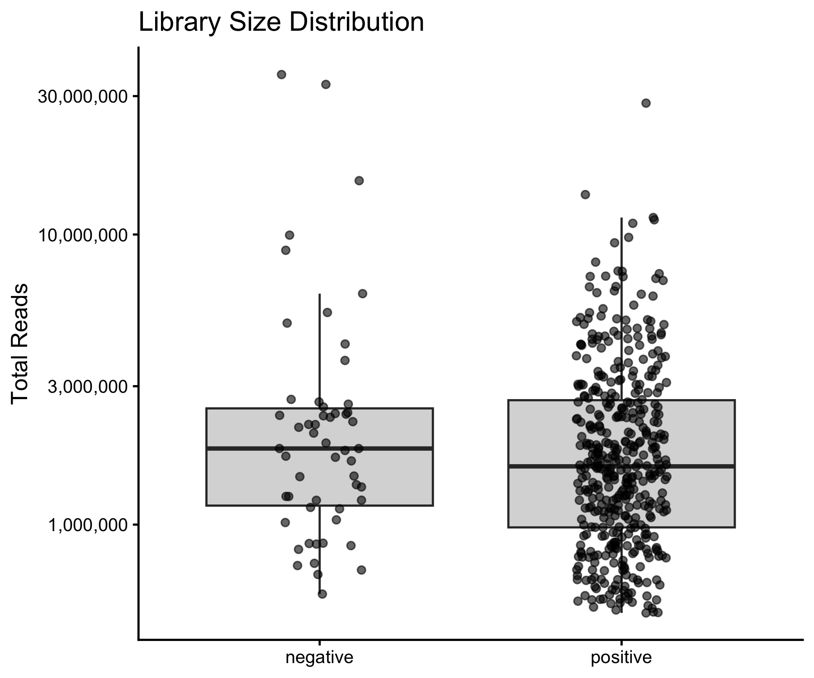

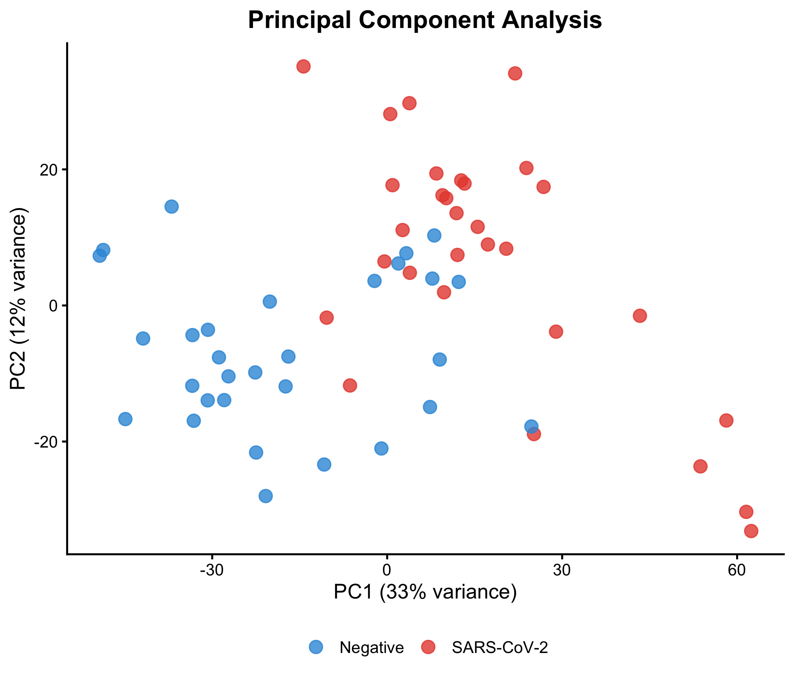

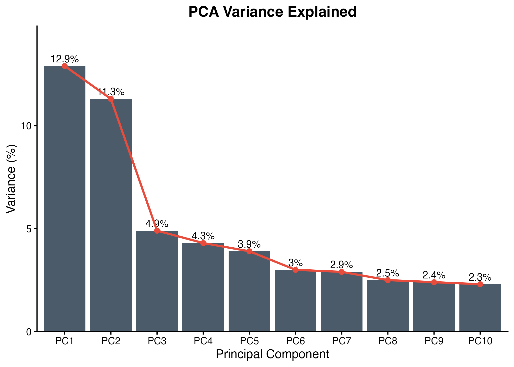

The MA and dispersion plots show effect-size and model behaviour. Sample-distance
and top-gene heatmaps show how samples cluster by their expression profiles.

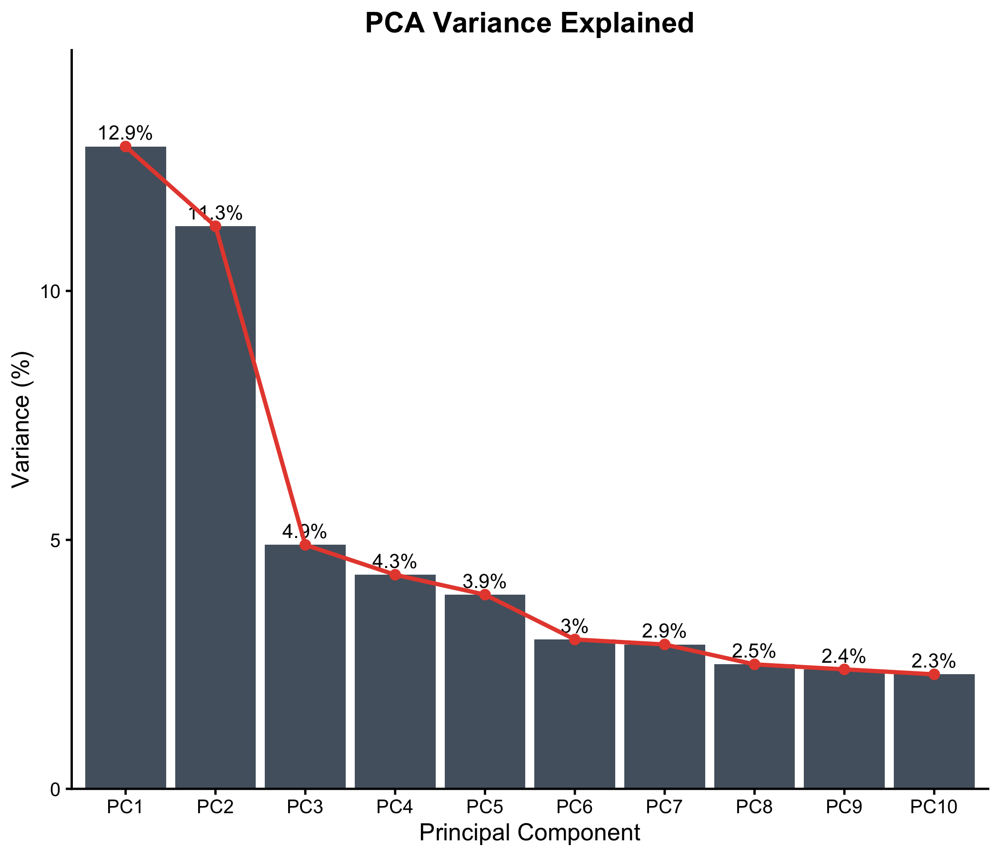

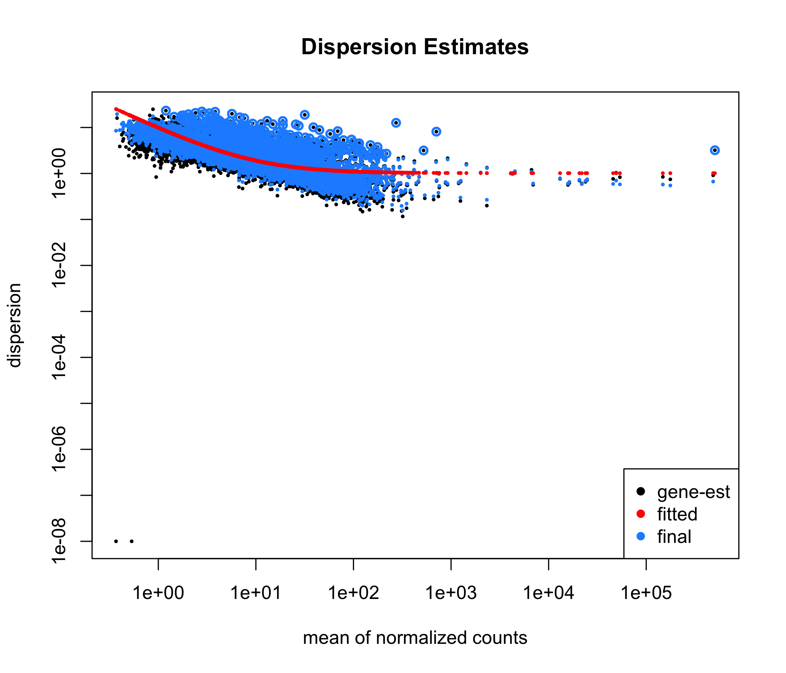

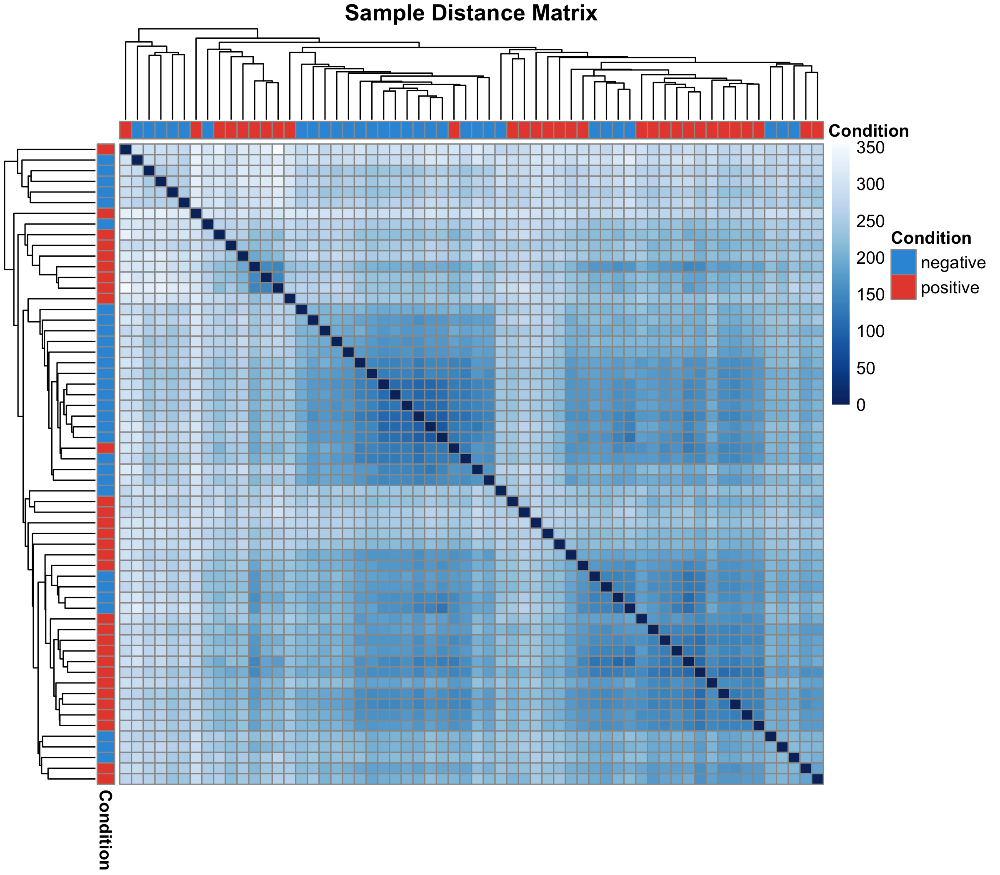

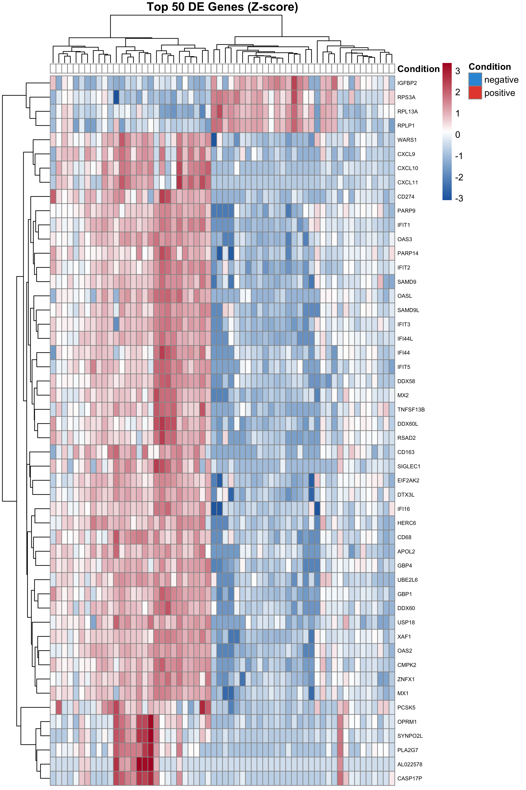

</details>

<details>
<summary>Exploratory analyses: viral load and recorded sex</summary>

**Viral load.** COVID-positive samples with N1 Ct measurements are split at the
median into higher viral load (lower Ct) and lower viral load groups. The plots
show differential expression and continuous associations between Ct and
interferon-stimulated gene expression. These are observational associations;
a median split also discards information present in continuous measurements.

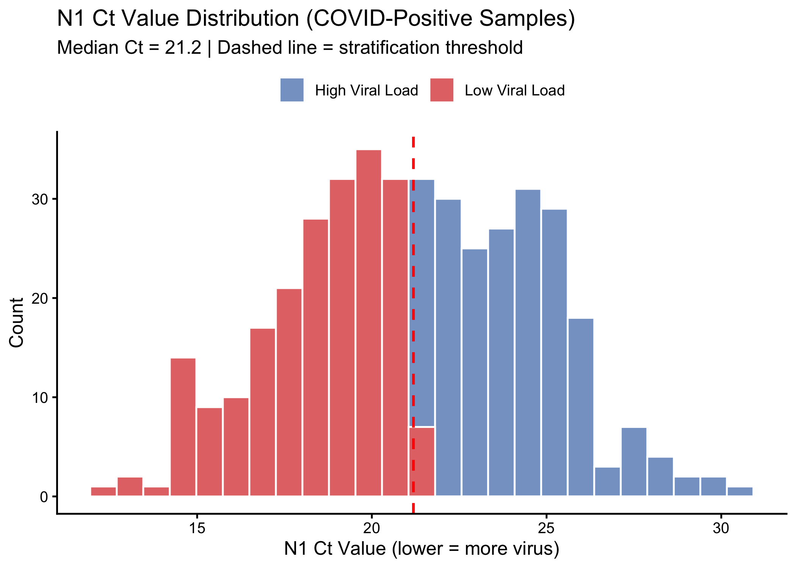

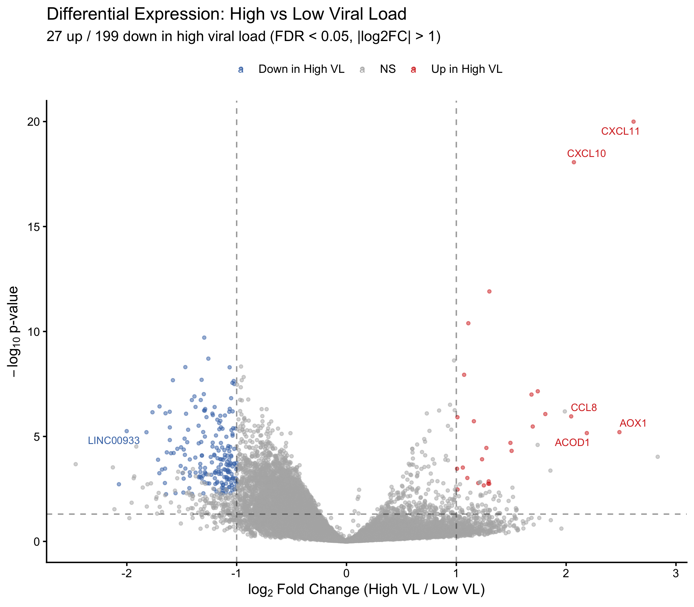

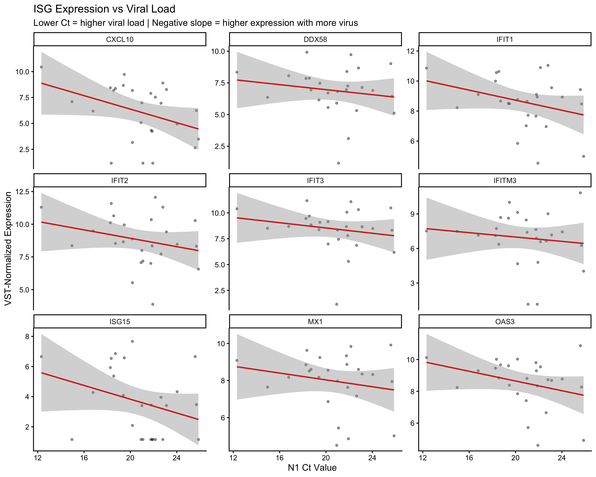

**Recorded sex.** The interaction model identifies **12 candidate genes** at
FDR &lt; 0.05 with different infection-associated responses by recorded sex.
Subgroup sizes and potential confounding limit interpretation; this does not
establish clinical risk or a causal sex-specific mechanism.

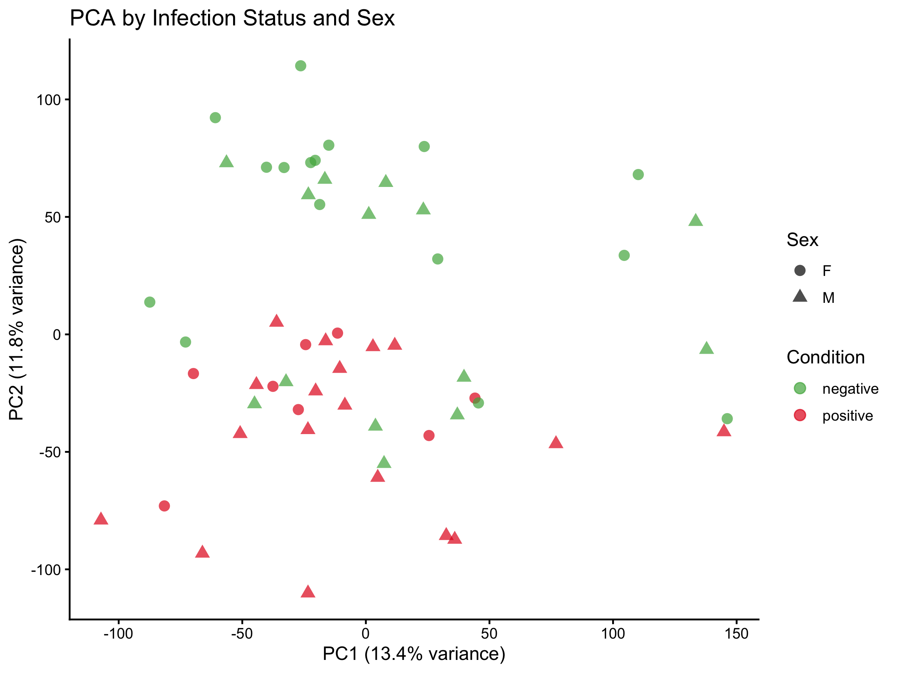

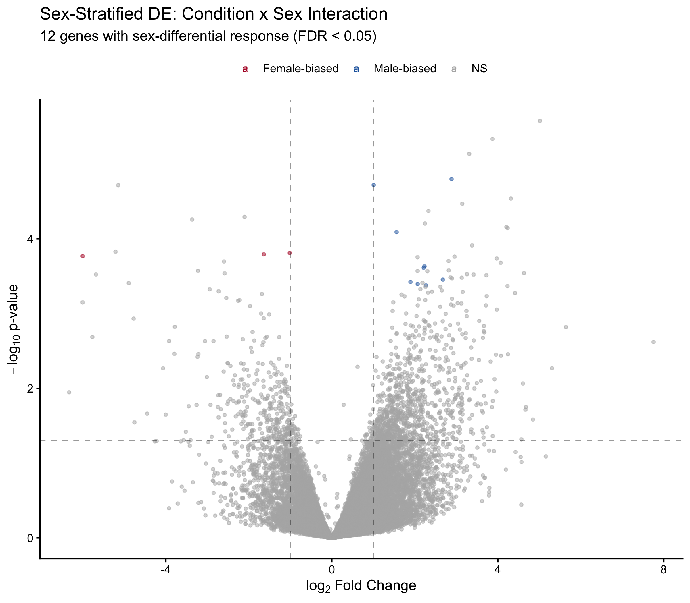

[Viral-load results](results/tables/viral_load_summary.csv) ·
[Sex-interaction results](results/tables/sex_analysis_summary.csv)

</details>

<details>
<summary>Workflow and repository structure</summary>

`run_all.R` runs the following stages in order:

| Stage | Script |
| --- | --- |
| Download counts and metadata | `scripts/00_get_data.R` |
| Align samples, clean gene IDs, apply QC and select the balanced subset | `scripts/01_qc.R` |
| Explore sample structure | `scripts/02_pca.R` |
| Fit differential expression and shrink effect sizes | `scripts/03_deseq2.R` |
| Plot differential expression | `scripts/04_visualisation_volcano.R` |
| Inspect model diagnostics | `scripts/05_model_diagnostics.R` |
| Test pathway enrichment | `scripts/06_enrichment.R` |
| Compare with the full cohort | `scripts/09_sensitivity_analysis.R` |
| Draw the pathway schematic | `scripts/08_pathway_diagram.R` |
| Explore viral-load and sex interactions | `scripts/10_viral_load_stratification.R`, `scripts/11_sex_stratified_analysis.R` |
| Record output checksums | `scripts/12_output_manifest.R` |
| Record environment and provenance | `scripts/07_reproducibility.R` |

Individual stages can be run from the repository root with
`Rscript scripts/<script_name>.R` once their input files exist.

| Location | Contents |
| --- | --- |
| `scripts/` | Analysis code and shared thresholds in `config.R` |
| `data/` | Downloaded and intermediate data; pinned KEGG references in `data/reference/` |
| `results/figures/` | Committed analysis figures |
| `results/tables/` | Gene results, enrichment, summaries and output manifest |
| `results/session_info.txt` | R/package versions, Git commit and run configuration |
| `renv.lock`, `renv/` | Pinned software environment |
| `tests/testthat/`, `dev/` | Output validation, lint and table comparison tools |
| `.github/workflows/ci.yml` | Environment checks, tests and clean pipeline rebuild |

</details>

## Reproducibility

Software versions, the sampling seed and KEGG references are pinned. CI rebuilds
the analysis, compares regenerated tables with committed outputs within numeric
tolerances, and checks that key figures were regenerated. The output manifest
records file sizes and MD5 checksums; session information records the environment
and Git revision.

[Reproduction guide](REPRODUCIBILITY.md) · [Environment](renv.lock) ·
[Provenance code](scripts/07_reproducibility.R) · [Output checksums](results/tables/output_manifest.csv)

## Limitations

- These are observational, cross-sectional nasal-swab data. They do not establish
  causation, temporal dynamics or responses elsewhere in the respiratory tract.
- Bulk RNA-seq combines cell types. Expression changes can reflect cell-composition
  differences as well as changes within cells.
- The primary model adjusts for recorded sex, but not every possible confounder.
  Balancing groups and checking the overlapping full cohort do not provide
  independent validation.
- Viral-load and sex-interaction analyses are exploratory; subgroup sizes and
  modelling choices limit their interpretation.

The companion [cell-type deconvolution analysis](https://github.com/Ekin-Kahraman/covid-airway-deconvolution)
explores estimated cell-composition differences in the same dataset.

## Data, citation and licence

**Analysis:** Ekin Kahraman (2026). *SARS-CoV-2 Host Response in Nasopharyngeal
RNA-seq*. [Zenodo DOI](https://doi.org/10.5281/zenodo.19429954).
Machine-readable citation: [CITATION.cff](CITATION.cff).

**Source study:** Lieberman NAP, Peddu V, Xie H, Shrestha L, Huang M-L, Mears MC,
*et al.* (2020). *In vivo antiviral host transcriptional response to SARS-CoV-2
by viral load, sex, and age*. **PLOS Biology** 18(9): e3000849.
[Paper](https://doi.org/10.1371/journal.pbio.3000849) ·
[GEO data](https://www.ncbi.nlm.nih.gov/geo/query/acc.cgi?acc=GSE152075) ·
[Original analysis code](https://github.com/greninger-lab/COVID19-RNAseq).

Code is available under the [MIT licence](LICENSE).
